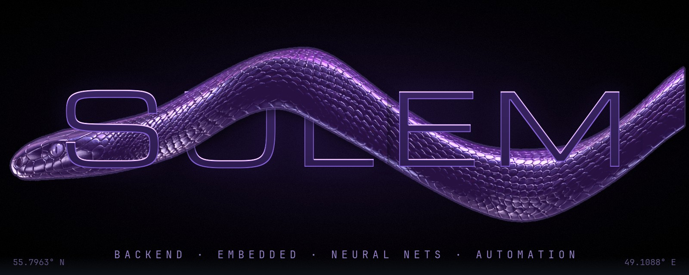
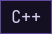
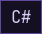
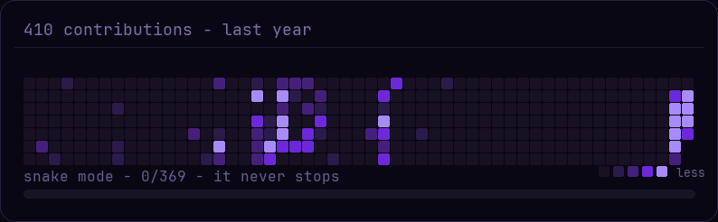
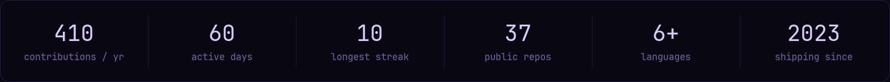
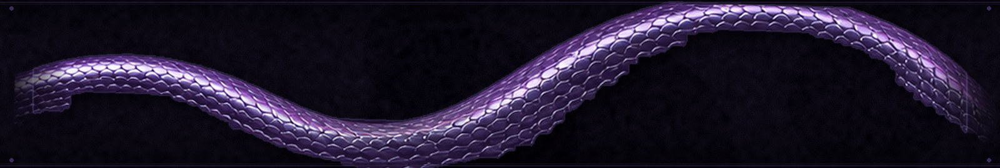
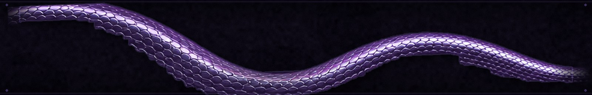
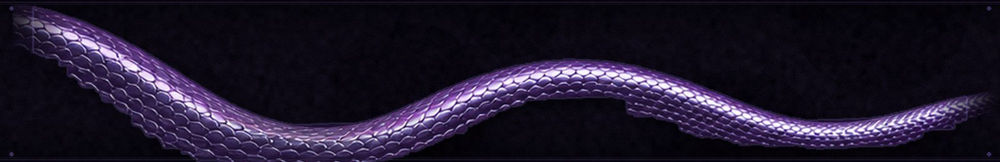
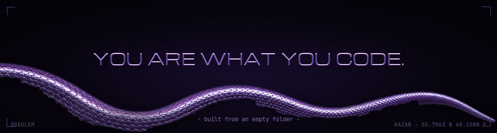

  

  

  
  
  
  
  
  
  
  
  
  
  
  

  

  

---

## `// about`

**Sulem** — backend engineer from Kazan.

I build the parts of systems nobody sees but everyone depends on:
APIs that don't blink, queues that don't leak, pipelines that just run.

Three languages, three altars:
**Python** for the servers — fast to write, easy to live with.
**C#** for the enterprise — typed, strict, reliable when it matters.
**C** for the chips — because real control still looks like registers and interrupts.

My default answer to any repetitive task is a script.
My default answer to a boring task is a cron job.
My default answer to "we've always done it manually" is a side project.

## `// off duty`

- **music** — rap, underground, hip-hop. beats half asleep, rhymes half awake
- **writing** verses — same skill as coding: rhythm, structure, no wasted words
- **flashing** microcontrollers — small chips, complete control, no layers in between
- **reading** about cybersecurity — you can't defend what you don't understand
- **philosophy** — mostly stoicism, sometimes wider

## `// philosophy`

**Stoicism is home base.**

*The obstacle is the way.* The bug, the outage, the rewrite — same rule:
what stands in the way becomes the way. Control what you can control —
your code, your habits, your reaction. The rest was never yours anyway.

Amor fati: the legacy codebase you inherited is also the practice you needed.

But i read wide — Camus for the absurd, Heraclitus for the flow,
Krishnamurti for the questions nobody answers. Stoics are the home,
not the cage.

> Marcus Aurelius · Seneca · Epictetus · Heraclitus

## `// i believe in`

- **automation over discipline** — the best habit is the one you don't have to remember
- **sharp tools** — a good script is worth a thousand meetings
- **small chips, big models** — the edge is the new mainframe
- **interest over roadmap** — the only honest filter for what to build next
- **shipped over perfect** — version 1 in prod beats version 2 in your head

---

## `// rule the machine`

`build` automations for everything — my life is quietly becoming a CLI
`flash` microcontrollers until they confess
`train` models, then shrink them until they fit anywhere
`hack` my own setups first — better me than someone else
`read` the docs nobody reads — that's where the power is
`delete` more code than i write

## `// next`

- wiring **personal automations** into everything — home, workflow, money, health
- exploring **next-gen startups** — where automation meets AI meets the edge
- looking for **interesting problems** — if it sounds fun, i'm already in

## `// toolbox`

| layer | gear |
|---|---|
| backend | Python · C# · .NET · REST APIs · message queues |
| metal | STM32 · ESP32 · bare AVR · interrupt sorcery |
| glue | Bash · GitHub Actions · Docker · CMake · cron |
| brains | PyTorch · ONNX · quantization tricks |
| curiously | cybersecurity · networks · exploit writeups |

## `// currently`

- shrinking quantized neural nets into microcontrollers —
  inference without an OS, a GPU, or excuses
- automating the boring parts of life before they notice
- re-reading *Meditations* — it hits different every year

## `// connect`

`kazan, russia` · `utc+3` · `ru / en`

open to: interesting problems · weird ideas · automation abuse

contact: **git blame**

---

  

